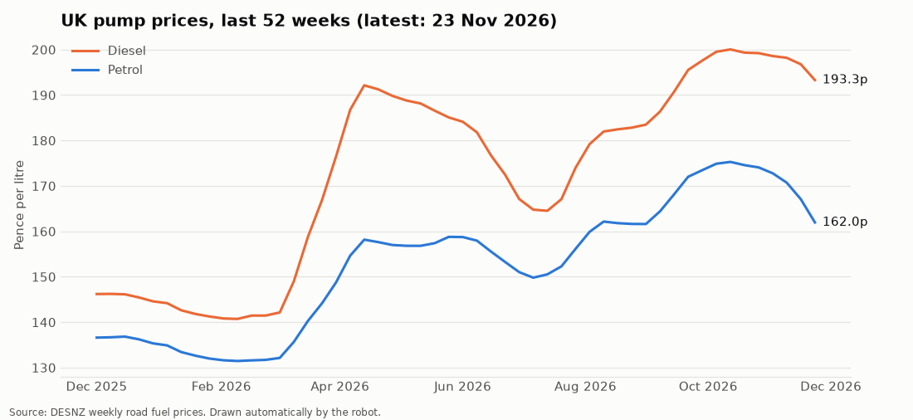

# Fuel price robot

[](https://github.com/azmain2704-ship-it/fuel-price-robot/actions/workflows/tests.yml)
[](https://github.com/azmain2704-ship-it/fuel-price-robot/actions/workflows/daily.yml)

The follow-up to my [UK fuel prices](https://github.com/azmain2704-ship-it/uk-fuel-prices) project. In that one I downloaded the government's CSV once and analysed it. This time I wanted the data to keep itself up to date, so a GitHub Action wakes up every morning, checks for new prices, saves them, redraws the chart below and emails me if petrol or diesel moves more than 5% in a week. There's also a Streamlit dashboard for looking through the data.

**Live dashboard: [uk-fuel-price-robot.streamlit.app](https://uk-fuel-price-robot.streamlit.app)** (it's on Streamlit's free hosting, so if nobody's opened it for a while you'll get a "gone to sleep" page. Click the button and it's back in about 30 seconds.)



*The robot draws this chart itself and commits it whenever new figures come out, so it's always current.*

## How it works

1. **Every day at 07:17 UTC** GitHub Actions runs `python -m robot.run` ([daily.yml](.github/workflows/daily.yml)).
2. The robot asks the **GOV.UK Content API** where the latest weekly prices CSV is. The government uploads a new file every week under a different URL, so hard-coding the link would break after a week. The Content API is public and needs no key.
3. It downloads the CSV and saves any new weeks to a **SQLite database** (`data/prices.db`). If the government revises an old week, the robot updates it. If nothing has changed, it saves nothing.
4. If anything changed, it redraws `charts/prices.png` with matplotlib.
5. Every run gets logged in the database, failed ones included, and the Action commits the database and chart back to the repo. The commit history doubles as a log of the robot working.
6. If a **new** week has come in and either fuel moved more than 5%, the Action opens a GitHub issue and @mentions me, so GitHub emails me. It only checks when a new week arrives. Otherwise the same jump would get reported every day until the next update.

New figures only come out once a week (Monday's prices, usually published on Tuesday), so most days the robot finds nothing new. Running it daily means a new week gets picked up within a day of coming out.

## Why prices are stored as whole numbers

Same idea as my money tracker. 167.07p is saved as `16707` (hundredths of a penny), so comparisons and percentage changes are worked out on exact integers, not floats. The dashboard divides by 100 only when it's showing a number.

## Things I had to think about

- **Running it twice shouldn't break anything.** GitHub sometimes runs scheduled jobs late or twice, and I might run it by hand too. Saving is idempotent: the same data in means no duplicate rows.
- **Failing loudly.** If GOV.UK renames a column or the download fails, the robot logs the failure and exits with an error. The Action goes red and GitHub emails me. It never saves half-read data.
- **No secrets needed.** The alert uses the token GitHub gives every workflow, so there's no email password stored anywhere.
- **Testing the alert.** Real 5% weekly jumps are rare, so the Action has a "test alert" switch. Click *Run workflow* on the Actions tab, tick it, and a test issue arrives.

## The dashboard

`dashboard.py` is a Streamlit page that reads the same database. It shows this week's prices and the change since last week, a chart you can hover over and set to 6 months, 1 year, 2 years or everything since 2018, the numbers as a table, a forecast for the next 4 weeks and a log of the robot's recent runs.

## Forecasting the next 4 weeks

My first idea was to fit a straight line through the last 4 weeks and carry it on. Before trusting it I backtested it: replay the last 52 weeks, predict each one using only the weeks before it, and compare it with the simplest guess there is, "same as last week". The straight line lost (1.77p average miss for petrol, against 1.56p).

So I looked at the weekly *changes* instead. A week's change is usually followed by another one in the same direction, so just repeating last week's change already cut the miss to 0.92p. Then I used scikit-learn's LinearRegression to learn how much of a change actually carries on. It's about 78% for petrol and 80% for diesel, not the full 100% that "repeat" assumes. That's the forecast the dashboard shows.

| Average miss, next week's price (last 52 weeks) | Petrol | Diesel |
|---|---|---|
| Same as last week | 1.56p | 2.42p |
| Straight line through 4 weeks | 1.77p | 2.50p |
| Repeat last week's change | 0.92p | 1.39p |
| **Momentum (used on the dashboard)** | **0.93p** | **1.33p** |

To be honest about it: on petrol over the last year, momentum and "repeat" are basically level. Momentum is ahead on diesel, and when I ran the same test on the year before and on everything since 2019, it came out best every time. Either way, both cut the error by about 40% compared with "same as last week". It can't predict shocks like a sudden oil price jump, and the further ahead it looks the less it can be trusted. The code is in `robot/forecast.py`.

## Running it yourself

On Windows, double-click `run_robot.bat`. It sets everything up the first time, collects the latest prices and opens the dashboard. Or by hand:

```bash
python -m venv .venv
.venv\Scripts\activate          # macOS/Linux: source .venv/bin/activate
pip install -r requirements.txt
python -m robot.run             # collect the latest prices
streamlit run dashboard.py      # open the dashboard
```

## Tests

`pytest` runs 31 tests against a saved copy of the real CSV and a fake API response, so they don't need the internet. They cover:

- finding the right CSV (not the old 2003 to 2017 one)
- reading the real file format
- exact price conversion
- not saving duplicates, and updating revised weeks
- the 5% rule (exactly 5% doesn't count)
- an alert only firing once per jump
- failures getting logged
- the chart only being redrawn when something changed
- the forecast: each method on simple made-up prices, the model learning the right carry-over, and the backtest never seeing the week it's predicting

## Built with

Python, requests, SQLite, GitHub Actions, matplotlib, scikit-learn, Streamlit and Altair, with pytest for the tests.

## Data

Weekly road fuel prices from the Department for Energy Security and Net Zero, published under the Open Government Licence v3.0.

## Next

Since February 2026 every UK forecourt has to report its prices to the government's Fuel Finder service within 30 minutes of a change. Its API needs a free GOV.UK One Login and an approved application. Once I have access, the plan is to add daily station-level prices next to the weekly averages, so I can see things like how much supermarkets undercut everyone else in Cardiff.
